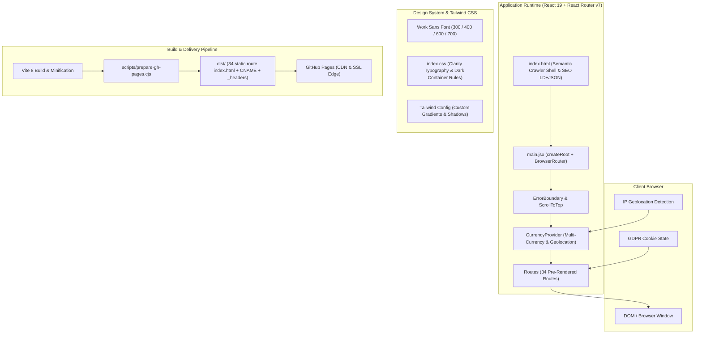
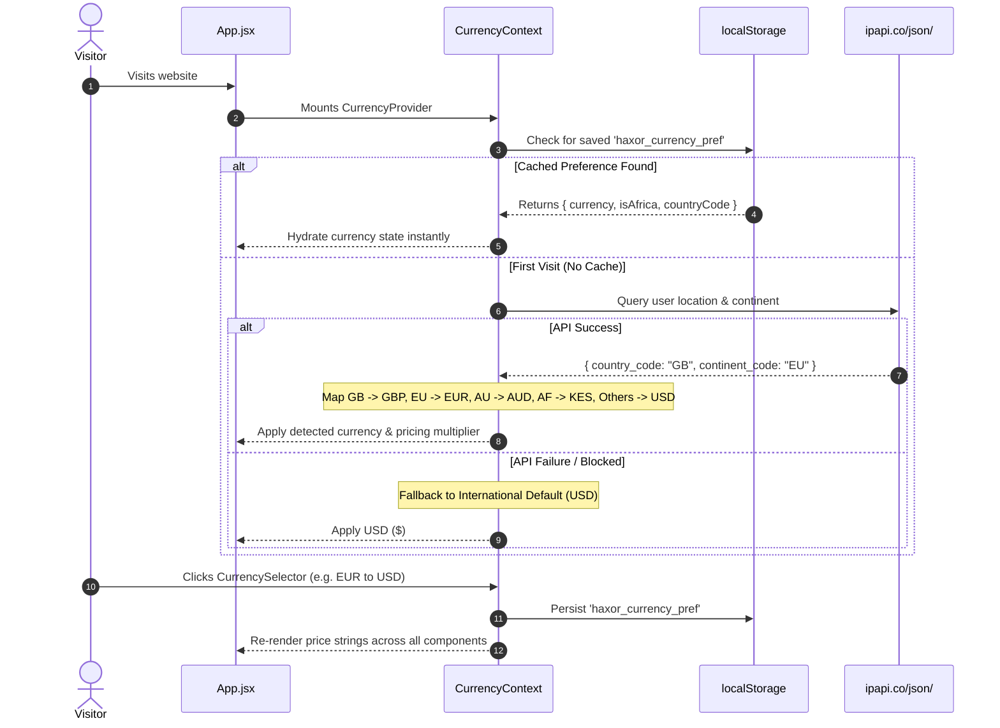

# Haxor MTC Website Architecture & Engineering Documentation

> **Production URL:** [https://haxormtc.com](https://haxormtc.com)  
> **Repository:** `KimJon/haxormtc`  
> **Branch Strategy:** `main` (Source code) / `gh-pages` (Production deployment)  
> **Last Updated:** October 2026  
> **Standard:** Monochromatic Clarity Performance Design Standard  

---

## 1. Executive Summary & Brand Positioning

**Haxor MTC (Haxor Management & Technology Consultants)** is an international B2B software engineering, CRM implementation, and workflow automation firm. The company operates as a **behind-the-scenes technical delivery and white-label capacity partner** for digital agencies, consultancies, and mid-market enterprises across the United Kingdom, Europe (CET), Australia (AEST), North America, and emerging markets.

### Key Value Propositions
- **100% White-Label Delivery:** Strict non-disclosure agreements (NDAs) ensuring digital agencies can sell enterprise CRM, ERP, and automation services under their own agency branding with zero client-poaching risk.
- **Enterprise Ecosystem Competency:** Certified systems delivery covering **Zoho (Zoho One/CRM/Creator)**, **Odoo Enterprise & Community ERP**, **HubSpot**, **Stripe / PayPal Billing Gateways**, and **Meta / Google Conversion APIs**.
- **Monochromatic Clarity Aesthetic:** Inspired by high-end enterprise technical consulting aesthetics (Clarity Performance standard), featuring ultra-refined typography, generous whitespace, high contrast, and responsive layout hierarchies.

---

## 2. Technology Stack & Architecture



### Core Technologies
| Layer | Technology | Version | Purpose |
|---|---|---|---|
| **Runtime / UI** | React | `^19.2.8` | Declarative UI components & Concurrent Mode rendering |
| **DOM Engine** | React DOM | `^19.2.8` | React DOM rendering for web |
| **Routing** | React Router DOM | `^7.18.3` | Client-side routing, route param parsing, and history |
| **Build Tool** | Vite | `^8.2.2` | Lightning-fast ESM bundler, dev server, and production compiler |
| **Styling** | Tailwind CSS | `^3.4.19` | Utility-first responsive CSS framework with customized tokens |
| **CSS Processing**| PostCSS & Autoprefixer | `^8.5.28` / `^10.5.5` | Cross-browser CSS prefixing and compilation |
| **Icons** | Lucide React | `^1.42.0` | Monochromatic SVG icons across all interfaces |
| **Linter** | Oxlint | `^1.79.0` | Ultra-fast Rust-based static code analyzer |
| **Deployment** | `gh-pages` | `^6.3.0` | Automated git worktree publishing to the `gh-pages` branch |

---

## 3. Design System & Typography Specifications

The website strictly follows the **Clarity Performance Typography & Design Standard**:

### Typography Hierarchy (`"Work Sans"`)
```css
/* Primary Headings (H1 / .clarity-h1) */
font-family: "Work Sans", -apple-system, BlinkMacSystemFont, "Segoe UI", sans-serif;
font-size: 52px;
font-weight: 300;
line-height: 55px;
letter-spacing: -1.82px;
color: currentColor; /* Responsive to container theme */

/* Mobile H1 (< 768px) */
font-size: 36px;
line-height: 40px;
letter-spacing: -1.2px;

/* Subheadings (H2 / .clarity-h2) */
font-size: 38px;
font-weight: 300;
line-height: 44px;
letter-spacing: -1.4px;

/* Mobile H2 (< 768px) */
font-size: 28px;
line-height: 34px;
letter-spacing: -0.8px;

/* Section Titles (H3 / .clarity-h3) */
font-size: 22px;
font-weight: 400;
line-height: 28px;
letter-spacing: -0.6px;

/* Body Text / Textareas */
font-family: "Work Sans", -apple-system, BlinkMacSystemFont, "Segoe UI", sans-serif;
font-size: 18px;
font-weight: 400;
line-height: 27px;
```

### Color Palette & Monochromatic Standards
- **Backgrounds:** Pure White (`#FFFFFF`) for primary body sections, Ultra-light slate (`#F8FAFC` / `#F1F5F9`) for alternate cards and micro-chips, and Deep Black (`#111111` / `#000000`) for headers, footers, and inverted callout panels.
- **Dark Container Color Inversion:** Rules in `src/index.css` enforce that whenever a dark container (`[class*="bg-black"]`, `[class*="bg-[#111111]"]`, `.dark-section`, etc.) is used, all nested `h1, h2, h3, h4, p, textarea` automatically render with `#FFFFFF` or `rgba(255,255,255,0.88)` to ensure 100% contrast and legibility.
- **Card Design:** Monochromatic `.clean-card` and `.clean-card-hover` utilities with subtle 1px slate borders (`#E2E8F0`), micro box-shadows, and smooth 250ms elevation transitions on hover.

### Official Vector Logos
Integrated into `src/components/OfficialLogos.jsx` using high-fidelity inline SVGs:
- **Odoo:** Official vector geometric wordmark with optional monochrome/color mode.
- **Zoho:** Official 4-color block emblem (Red, Green, Blue, Orange) and white inner letterforms.
- **Google:** Official 4-color "G" vector mark.
- **Meta:** Official infinity loop emblem.
- **Stripe:** Official wordmark geometry.

---

## 4. Routing Table & Route Architecture

The site uses a hybrid routing model: React Router client-side navigation (`BrowserRouter`) combined with **34 pre-generated static `index.html` directories** generated at build time by `scripts/prepare-gh-pages.cjs`. This provides 100% direct-URL access without 404 flashing on static hosts like GitHub Pages.

```
/                              -> Home.jsx (Main Enterprise Portal)
├── /agency-partners           -> AgencyPartnersPage.jsx (White-Label Delivery Hub)
├── /services                  -> ServicesPage.jsx (Directory of Technical Capabilities)
│   ├── /crm-implementation    -> CrmImplementationPage.jsx (Zoho, Odoo, HubSpot)
│   ├── /business-automation   -> BusinessAutomationPage.jsx (Webhooks, n8n, Make, APIs)
│   ├── /integrations          -> IntegrationsPage.jsx (Payment, ERP & Cloud Connectors)
│   ├── /google-family-link    -> GoogleFamilyLinkPage.jsx (Dedicated Parental Control Lander)
│   └── /:slug                 -> LandingPage.jsx (Dynamic Ad-Campaign Landers)
├── /software                  -> SoftwarePage.jsx (Turnkey SaaS & System Platforms)
│   └── /:slug                 -> LandingPage.jsx (Dynamic Software Landers)
├── /kits                      -> BusinessKitsPage.jsx (All-in-One Turnkey Industry Kits)
├── /solutions/kits            -> BusinessKitsPage.jsx (Alias)
├── /portfolio                 -> PortfolioPage.jsx (Case Studies & Delivery Proof)
├── /work                      -> PortfolioPage.jsx (Alias)
├── /calculator                -> CalculatorPage.jsx (Interactive Scoping & Estimator)
├── /why-us                    -> WhyUsPage.jsx (Comparative Architecture & SLA Proof)
├── /about                     -> AboutPage.jsx (Engineering Team & Standards)
├── /about-us                  -> AboutPage.jsx (Alias)
├── /contact                   -> ContactPage.jsx (Direct Engineering Desk)
└── /education
    ├── /family-link           -> GoogleFamilyLinkPage.jsx (Alias)
    └── /google-family-link    -> GoogleFamilyLinkPage.jsx (Alias)
```

---

## 5. State Management & Global Contexts

### 5.1 Currency & Region Intelligence (`CurrencyContext.jsx`)
Automatically detects the visitor's continent, country code, and currency on page load, with fallback to manual user selection and `localStorage` persistence.



#### International Multiplier Mechanics
- **Domestic (Africa/KES):** Direct base pricing (`multiplier = 1`).
- **International (UK, EU, US, AU):** Applies a silent `2.1x` enterprise international multiplier before converting through dynamic exchange rates (`USD: 130`, `GBP: 168`, `EUR: 142`, `AUD: 86`).
- **Dynamic Formatting:** Numbers are rounded cleanly to nearest $5 or $10, prepending appropriate symbols (`$`, `£`, `€`, `A$`, `KSh`) and appending recurring suffixes (`/mo`, `/hr`).

---

### 5.2 EU GDPR & ePrivacy Cookie Consent (`CookieConsentBanner.jsx`)
To ensure compliance with European Union GDPR, ePrivacy Directive, and UK PECR regulations:
- **Equal Prominence:** The banner provides equal visual balance between **"Accept All"** and **"Essential Only"** buttons.
- **Granular Customization Drawer:** Visitors can open an interactive accordion to independently toggle:
  1. *Strictly Necessary Cookies:* Required for site operation and security (permanently enabled).
  2. *Performance & Analytics Cookies:* Aggregated diagnostic data.
  3. *Marketing & Advertising Cookies:* Campaign attribution.
- **Persistent Consent Storage:** Saved under key `haxor_cookie_consent_v1` in `localStorage`.
- **Re-Openable Anytime:** A dedicated "Cookie Preferences" button in `Footer.jsx` dispatches a custom browser event `open-cookie-preferences`, re-opening the settings drawer at will.

---

## 6. Component Catalog & Architecture

| Component | Path | Purpose & Notable Features |
|---|---|---|
| **`TopTicker.jsx`** | `src/components/TopTicker.jsx` | Sticky top announcement bar highlighting white-label agency partnerships, direct email desk, currency switcher, and partner desk CTA. |
| **`Navbar.jsx`** | `src/components/Navbar.jsx` | Fixed header with brand logo, multi-level hover-debounced services dropdown, currency dropdown, mobile navigation menu, and direct WhatsApp scoping button. |
| **`BrandLogo.jsx`** | `src/components/BrandLogo.jsx` | Responsive brand logo renderer with `dark` (default) and `light` (inverted container) variants. |
| **`CookieConsentBanner.jsx`** | `src/components/CookieConsentBanner.jsx` | EU GDPR compliant consent manager with drawer toggles and persistent choice memory. |
| **`CurrencySelector.jsx`** | `src/components/CurrencySelector.jsx` | Accessible currency switcher supporting USD, GBP, EUR, AUD, and KES. Supports modal or compact inline display. |
| **`QuoteCalculator.jsx`** | `src/components/QuoteCalculator.jsx` | Interactive project cost estimator allowing clients to select delivery scope, platform stack, and turnaround times to calculate live quotes. |
| **`BusinessKitsShowcase.jsx`**| `src/components/BusinessKitsShowcase.jsx` | Comprehensive multi-industry package showcase (Hospitality, Clinic, POS, Solar, Real Estate, Logistics). |
| **`PortfolioSection.jsx`** | `src/components/PortfolioSection.jsx` | Verified technical case studies showcasing measurable outcomes (85% manual time saved, 3.4x throughput, 99.9% uptime). |
| **`SocialProofSection.jsx`** | `src/components/SocialProofSection.jsx` | International client testimonials with authentic corporate portraits (Liam Vance, Freja Lindqvist, Callum Davies, Marcus Sterling). |
| **`WhyChooseUs.jsx`** | `src/components/WhyChooseUs.jsx` | Side-by-side comparison matrix: Haxor MTC Dedicated Engineering vs. Freelancer Marketplaces vs. Large Tier-1 Consultancies. |
| **`OfficialLogos.jsx`** | `src/components/OfficialLogos.jsx` | Pure SVG vector implementations of Zoho, Odoo, Google, Meta, and Stripe emblems. |
| **`PaymentMethods.jsx`** | `src/components/PaymentMethods.jsx` | Supported international payment rails: Stripe, PayPal, Mastercard, Visa, and direct bank wire. |
| **`FloatingWhatsApp.jsx`** | `src/components/FloatingWhatsApp.jsx` | Desktop floating quick-contact bubble with pulsing availability indicator and pre-filled inquiry text. |
| **`MobileBottomBar.jsx`** | `src/components/MobileBottomBar.jsx` | Thumb-optimized mobile navigation bar fixed at bottom for instant Email, WhatsApp, and Rates scoping. |
| **`ScrollToTopButton.jsx`** | `src/components/ScrollToTopButton.jsx` | Smooth scroll-to-top button appearing after 300px scroll threshold with smart offset to prevent overlapping floating bars. |
| **`Footer.jsx`** | `src/components/Footer.jsx` | Comprehensive 4-column footer containing technical delivery links, legal links, cookie preferences trigger, and timezone availability. |

---

## 7. Data Models & Store Schemas

### 7.1 `servicesData.js`
The master configuration repository for corporate contact details, pricing tiers, and service catalogs:
- **`CONTACT_INFO`**: Direct desk phone, WhatsApp number (`254729915459`), official email (`haxorconsults@gmail.com`), canonical domain (`haxormtc.com`), and global coverage description.
- **`createWhatsAppUrl(message)`**: Safe URI encoder formatting one-click direct chat links to technical architects.
- **`PRICING_LEVELS`**: 4 enterprise delivery tiers:
  1. *Technical Audit & Sprint:* Fixed-scope architecture reviews ($450 – $1,200).
  2. *CRM Implementation Sprint:* End-to-end Zoho/Odoo/HubSpot deployment ($1,800 – $3,500).
  3. *White-Label Agency Retainer:* Dedicated 40-80 hr/mo engineering capacity ($2,800 – $5,200/mo).
  4. *Enterprise Systems Architecture:* Multi-branch ERP & custom microservices (Custom Quote).

### 7.2 `industryKitsData.js`
Structured turnkey operational packages across 6 core industries:
- **`HOTEL_KIT`**: Hotel PMS, channel manager, automated guest check-in, POS dining integration.
- **`CLINIC_KIT`**: Patient booking, electronic health records (EHR), SMS appointment reminders, billing.
- **`RETAIL_KIT`**: Multi-counter POS, barcode inventory tracking, Stripe/card processing, supplier re-ordering.
- **`SOLAR_KIT`**: Field technician dispatch, solar PV quotes, warranty management, client portal.
- **`REALESTATE_KIT`**: Property listing sync, tenant lead distribution, lease renewal automations.
- **`LOGISTICS_KIT`**: Waybill tracking, driver assignments, route webhook status updates, fleet maintenance logs.

### 7.3 `landingPagesData.js`
Deep-funnel ad conversion data structures containing:
- Specific hero headlines, subheadlines, and badges.
- Dynamic WhatsApp action payloads.
- Structured feature checklists with icons and impact metrics.
- Targeted FAQs with expandable accordion logic.

---

## 8. Security, Compliance & Anti-WAF Architecture

### 8.1 HTTP Security Headers (`dist/_headers` & `index.html`)
The application deploys with hardened enterprise security headers:
```http
X-Frame-Options: DENY
X-Content-Type-Options: nosniff
Referrer-Policy: strict-origin-when-cross-origin
Permissions-Policy: camera=(), microphone=(), geolocation=(), payment=()
Strict-Transport-Security: max-age=31536000; includeSubDomains; preload
Content-Security-Policy: default-src 'self'; script-src 'self' 'unsafe-inline'; style-src 'self' 'unsafe-inline' https://fonts.googleapis.com; font-src 'self' https://fonts.gstatic.com data:; img-src 'self' data: https: blob:; connect-src 'self' https://api.whatsapp.com https://ipapi.co; object-src 'none'; base-uri 'self'; form-action 'self' https://api.whatsapp.com https://wa.me; frame-ancestors 'none';
```

### 8.2 WAF & Shared-Host False Positive Defense
To prevent aggressive Web Application Firewalls (such as cPanel ModSecurity or Imunify360 heuristic scanners) from falsely quarantining files:
- Minimized inline executable strings in raw HTML shells.
- Externalized complex logic to compiled, minified JS bundles.
- Pure semantic crawler shell in `index.html` allowing Googlebot and Bingbot full indexing without triggering regex-based heuristic alarms.

---

## 9. Search Engine Optimization (SEO) & Structured Data

1. **JSON-LD Schema Graph (`index.html`):**
   - **`Organization`**: Defines Haxor MTC, official logo, contact endpoints, countries served (UK, Germany, Netherlands, Australia, US, Canada), and competencies.
   - **`WebSite`**: Canonical search entity.
   - **`ProfessionalService` & `OfferCatalog`**: Enumerates the 4 core implementation services with price ranges.
2. **Canonical Indexing:**
   - Every page declares `<link rel="canonical" href="https://haxormtc.com/..." />`.
   - `public/sitemap.xml` provides full coverage for 34 routes with weekly change frequency and priority weighting from `0.75` to `1.0`.
   - `public/robots.txt` disallows sensitive asset maps while permitting search crawlers.

---

## 10. Build, Deployment & Operations Manual

### Local Development
```powershell
# Install dependencies
npm install

# Start local Vite development server
npm run dev

# Run static linter
npm run lint
```

### Production Build & Static Site Generation
```powershell
# Build application and generate GitHub Pages routes
npm run build
```
Execution order:
1. `vite build`: Compiles and bundles React components to `dist/assets/`.
2. `scripts/prepare-gh-pages.cjs`:
   - Duplicates `dist/index.html` to `dist/404.html` (SPA fallback).
   - Writes `dist/CNAME` with `haxormtc.com`.
   - Writes `dist/.nojekyll` to disable Jekyll parser.
   - Writes `dist/_headers` for edge security.
   - Parses `sitemap.xml` and pre-generates physical directories for all 34 routes containing an `index.html`.

### Deployment to GitHub Pages
```powershell
# Build and deploy directly to gh-pages branch
npm run deploy
```

---

## 11. Maintenance & Extension Guidelines

### Adding a New Service Page
1. Define the service record in `src/data/servicesData.js` (or `landingPagesData.js` if it is an ad lander).
2. Register the route in `src/App.jsx` under `<Routes>`.
3. Add the new URL to `public/sitemap.xml` and `scripts/prepare-gh-pages.cjs` in the `routes` set.
4. Add the navigation link in `src/components/Navbar.jsx` under the `services` array and `src/components/Footer.jsx`.

### Adding a New Currency
1. Open `src/context/CurrencyContext.jsx`.
2. Add the currency key and conversion factor to `EXCHANGE_RATES`.
3. Add the currency symbol to `CURRENCY_SYMBOLS`.
4. Add the option to the `<select>` dropdown in `src/components/CurrencySelector.jsx`.
